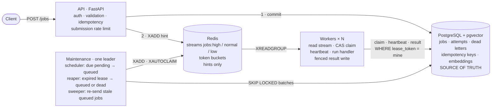

# Distributed Workflow Engine

A distributed job-processing engine in Python. Clients submit jobs over an HTTP API, and a pool of
workers runs them with retries, dead-lettering, idempotent submission, priorities, delayed jobs,
cancellation, rate limiting, and crash recovery. **PostgreSQL is the source of truth; Redis
Streams only carry wake-up hints**, so Redis can lose everything and no job is lost.

The guarantee: **at-least-once execution, with each job's result saved exactly once.** A worker
can be killed mid-job, Redis can be wiped, a slow worker can come back after its lease was taken,
and every job still ends in exactly one terminal state.


*`make demo`: a worker is SIGKILLed mid-job. Its lease expires, the reaper puts the job back in
the queue, and another worker finishes it. The result is saved once, under lease token 2.*

## Contents

- [Features](#features)
- [Architecture](#architecture)
- [Quickstart](#quickstart)
- [API examples](#api-examples)
- [Delivery guarantees](#delivery-guarantees)
- [Benchmarks](#benchmarks)
- [Design trade-offs](#design-trade-offs)
- [Testing strategy](#testing-strategy)
- [Kubernetes (kind)](#kubernetes-kind)
- [Project layout](#project-layout)
- [Further reading](#further-reading)

## Features

- **Crash recovery.** Workers hold a lease in Postgres and renew it with heartbeats. When a
  worker dies, the reaper takes the job back after the lease runs out.
- **Fencing tokens.** Every write a worker makes after claiming a job checks its lease token, so a
  "zombie" worker that comes back late can't overwrite the new owner's result.
- **Retries with full-jitter exponential backoff,** then a dead-letter queue with a requeue
  endpoint.
- **Idempotent submission.** An `Idempotency-Key` header is scoped per API key: the same body
  returns the original job, and a different body gets 409. Concurrent duplicates make one row.
- **Three priorities** (`high`, `normal`, `low`), **delayed jobs** (`run_at`), and
  **cancellation** of pending, queued, or running jobs.
- **Two rate limiters** built on one Redis Lua token bucket. One throttles execution per job type
  (delays jobs, never rejects them). The other limits submissions per API key (429 with
  `Retry-After`). Both fail open if Redis is down.
- **Graceful shutdown.** On SIGTERM a worker stops reading, lets in-flight jobs finish within a
  grace period, then hands any job still running back to the queue.
- **Observability.** JSON logs with `job_id`, `trace_id`, and more bound in context.
  OpenTelemetry traces run from the HTTP request through the stream into the worker. Prometheus
  metrics cover throughput, latency, queue depth, retries, DLQ size, reaped leases, and rate
  limiting.
- **An ML job type.** `embed_texts` embeds text with a small ONNX model (fastembed,
  `BAAI/bge-small-en-v1.5`, no PyTorch) into pgvector, and `GET /embeddings/search` runs
  semantic search over the stored vectors with an HNSW index.

## Architecture



A job's life:

1. `POST /jobs` commits the job to Postgres as `queued` (or `pending` if `run_at` is in the
   future), and only then XADDs its id to the stream for its priority.
2. A worker reads the entry and **claims** the job with one conditional update:
   `UPDATE jobs SET status='running', lease_token=lease_token+1, … WHERE id=… AND status='queued'
   RETURNING lease_token`. If no row comes back, the entry was stale or a duplicate, and the
   worker ACKs it and moves on.
3. While the handler runs, a heartbeat extends `lease_expires_at`, but only while `lease_token`
   still matches.
4. The result, retry, or dead-letter write also carries `WHERE lease_token = :mine`.
5. The maintenance process repairs everything else: it promotes due `pending` jobs, reaps expired
   leases, and re-sends `queued` jobs whose hint went missing. It holds a Postgres advisory lock,
   so only one copy is active even when several run.

States: `pending → queued → running → succeeded | dead | cancelled`, with retries going
`running → pending` (with a backoff `run_at`) and an expired lease going `running → queued`. The
full state machine and the data model are in [docs/architecture.md](docs/architecture.md).

## Quickstart

You need Docker (with Compose v2), [uv](https://docs.astral.sh/uv/), and `make`.

```bash
git clone https://github.com/HarshaM30/distributed-workflow-engine.git
cd distributed-workflow-engine
make up && make demo
```

`make up` creates `.env` from `.env.example` if you don't have one (placeholder values, fine for
local use) and starts Postgres and Redis. `make demo` builds the image, starts the API, the
maintenance process, and three workers with a 5-second lease, and runs the scripted demo shown
in the GIF. The first run takes a few minutes to build the image and install dependencies.

When you're done:

```bash
make down          # stop and remove the containers (data volumes are kept)
```

To run the processes directly on your machine instead of in containers:

```bash
make install       # uv sync
make up migrate    # Postgres + Redis, then alembic upgrade head
make api           # http://localhost:8000, OpenAPI docs at /docs
make worker        # in another terminal; start as many as you like
make maintenance   # in another terminal
```

`make help` lists every target. Tracing is optional: `make tracing-up` starts Jaeger (UI on
http://localhost:16686), and processes started with `OTEL_ENABLED=true` export spans to it.

## API examples

Every route except `/health` and `/metrics` needs an `X-API-Key` header. Keys come from
`API_KEYS` in `.env` (`change-me-dev-key` in `.env.example`).

```bash
KEY=change-me-dev-key
API=http://localhost:8000
```

Submit a job (201, or 200 when the same `Idempotency-Key` and body are replayed):

```bash
curl -s -X POST $API/jobs -H "X-API-Key: $KEY" -H "Content-Type: application/json" \
  -H "Idempotency-Key: order-1234" \
  -d '{"type": "sleep", "payload": {"seconds": 2}, "priority": "high"}'
```

```json
{"id": "7c9e6679-7425-40de-944b-e07fc1f90ae7", "type": "sleep", "status": "queued",
 "priority": "high", "attempts": 0, "max_attempts": 5, "result": null, "...": "..."}
```

Run it later, or give it a retry budget:

```bash
curl -s -X POST $API/jobs -H "X-API-Key: $KEY" -H "Content-Type: application/json" \
  -d '{"type": "flaky", "payload": {"failure_rate": 0.5}, "max_attempts": 3,
       "run_at": "2030-01-01T09:00:00Z"}'
```

Look a job up, with its attempt history, or list jobs with keyset pagination:

```bash
curl -s $API/jobs/<id> -H "X-API-Key: $KEY"
curl -s "$API/jobs?status=running&type=sleep&limit=50" -H "X-API-Key: $KEY"
```

Cancel a job (200 if it was pending or queued; 202 if it's running and will stop at its next
heartbeat; 409 if it already finished):

```bash
curl -s -X POST $API/jobs/<id>/cancel -H "X-API-Key: $KEY"
```

Dead-letter queue:

```bash
curl -s "$API/dlq?limit=20" -H "X-API-Key: $KEY"
curl -s -X POST $API/dlq/<dead_letter_id>/requeue -H "X-API-Key: $KEY"
```

Embed texts, then search them:

```bash
curl -s -X POST $API/jobs -H "X-API-Key: $KEY" -H "Content-Type: application/json" \
  -d '{"type": "embed_texts", "payload": {"texts": ["The cat sat on the mat.",
       "Stock markets fell sharply on Monday.", "A kitten is napping on a rug."]}}'
curl -s "$API/embeddings/search?q=a%20sleeping%20cat&k=2" -H "X-API-Key: $KEY"
```

Health and metrics (no key needed):

```bash
curl -s $API/health      # 200 {"status": "ok", "components": {"postgres": ..., "redis": ...}} or 503
curl -s $API/metrics     # Prometheus text format
```

Built-in job types: `sleep`, `cpu` (SHA-256 rounds), `flaky` (fails with a given probability),
`embed_texts`, and `ledger` (used by the chaos tests). A new type is a decorated coroutine with a
Pydantic payload model:

```python
from pydantic import BaseModel
from workflow_engine.handlers.registry import JobContext, handler


class ResizePayload(BaseModel):
    image_url: str
    width: int


@handler("resize", payload_model=ResizePayload, max_attempts=4, timeout_seconds=60)
async def run(payload: ResizePayload, ctx: JobContext) -> dict[str, str]:
    ...  # must be idempotent: it can run more than once for the same ctx.job_id
    return {"thumbnail": "..."}
```

## Delivery guarantees

**At-least-once execution, with each job's result saved exactly once.**

- *At-least-once execution:* a handler can run more than once. If a worker dies mid-job, the
  reaper hands the job to another worker, and the first run's side effects may already have
  happened.
- *Result saved exactly once:* only one attempt's outcome is ever committed. Every write after a
  claim is fenced by the lease token, so a late or duplicate attempt is rejected by Postgres.
- So handlers must be idempotent: upsert on natural keys, as `embed_texts` does on
  `(job_id, item_index)`, or record side effects in a table keyed by the job.

The chaos run measures this instead of assuming it: 9 duplicate executions under 14 SIGKILLs,
every one a run cut short by a kill, and still exactly one terminal state per job.
[docs/delivery-guarantees.md](docs/delivery-guarantees.md) walks through the fencing protocol and
each failure scenario step by step.

## Benchmarks

Measured on an Apple M5 laptop (10 cores, 16 GB) with everything in one Docker Desktop VM. One
worker is one process running one job at a time. Full method, specs, and discussion are in
[benchmarks/results.md](benchmarks/results.md), and `make bench` reproduces them.

| Workers | `sleep(0)` jobs/s | `cpu` jobs/s (~10 ms each) |
|---:|---:|---:|
| 1 | 536 | 81 |
| 2 | 1,002 | 151 |
| 4 | 1,298 | 236 |
| 8 | 1,673 | 322 |

- `sleep(0)` measures the engine's own per-job cost (stream read, claim, completion, ACK). It
  scales 3.12x from 1 to 8 workers, as the workers start to contend for one Postgres.
- `cpu` jobs spend their time in the handler and scale 3.99x.
- At a steady 200 jobs/s through the API, the median job finishes about 2 ms after it was
  created. With 2 or more workers, p99 stays under 4 ms.
- **Chaos run:** 400 jobs, 4 workers, a SIGKILL about every 4 seconds (14 in all), and a Redis
  restart that wiped every stream and consumer group. Result: **0 lost jobs**, 0 phantom jobs,
  one terminal state per job, and orphaned leases reaped 4.37 s (p50) after the kill, inside the
  4 s lease + 1 s reaper bound.

## Design trade-offs

**Why not a Postgres-only queue with `SELECT … FOR UPDATE SKIP LOCKED`?** That design is simple
and correct, and it's a good default for many systems. Its costs show up with many workers:
idle workers have to poll the primary database (or you add `LISTEN/NOTIFY` and its edge cases),
every poll competes for the same hot rows and index, and polling interval trades latency
against database load. Here workers block on Redis (`XREADGROUP`) instead, so an idle pool costs
Postgres nothing, and a claim is a single-row update by primary key. The price is a second moving
part, which is why Redis is only allowed to hold hints: anything it loses, the sweeper rebuilds
from Postgres. `SKIP LOCKED` is still used where it fits best, in the maintenance batches
(scheduler, reaper, sweeper).

**Why Redis Streams over lists?** A list `BRPOP` removes the item on delivery, so a worker that
dies before finishing loses it unless you build per-worker processing lists (`LMOVE`) and your
own recovery. Streams give consumer groups with a pending-entries list per consumer, explicit
`XACK`, and `XAUTOCLAIM` to take over entries from dead consumers, plus entry ids and `MAXLEN`
trimming. Pub/Sub was out because it drops messages when no one is listening.

**Why commit first, then XADD?** If the API dies between the two, the job exists in Postgres with
no hint, and the sweeper re-sends it. The other order could leave a hint for a job that was never
committed. Re-sending is always safe because of the CAS claim.

**Why are all timers in Postgres?** Delayed jobs and retry backoff both set `run_at` on a
`pending` job, and the scheduler promotes due jobs. Redis never holds timers, so a Redis restart
can't drop a scheduled retry.

**Why one maintenance leader?** The scheduler, reaper, and sweeper are safe to run concurrently
(they use `SKIP LOCKED` and CAS updates), but one active copy keeps load and logs predictable. A
Postgres advisory lock picks the leader with no extra infrastructure, and a standby takes over
when the leader's connection drops.

**Why do the rate limiters fail open?** Postgres is the source of truth, so a Redis outage in the
limiter should slow nothing down and lose nothing. The cost is that limits aren't enforced while
Redis is down, and that is logged.

**Known limits.** One API process and one untuned Postgres in the benchmarks; three fixed
priority levels rather than arbitrary ones; job reads aren't scoped per API key; and handlers
must be idempotent, because exactly-once *execution* isn't something a system with crashing
workers can promise.

## Testing strategy

| Layer | What it covers | Command | Where it runs |
|---|---|---|---|
| Lint and types | ruff (lint and format), `mypy --strict` | `make lint` | every push (CI) |
| Unit | state machine and backoff bounds (with Hypothesis property tests), schemas, registry, config, manifests | `make test-unit` | every push (CI) |
| Integration | real Postgres and Redis: idempotency races, CAS claims, fencing against a zombie worker, retries and DLQ, `kill -9` and SIGTERM on real worker processes, Redis wiped mid-run, priorities, delays, cancellation, rate limits, tracing, embeddings search and its HNSW plan | `make test-integration` | every push (CI) |
| Chaos | a Docker stack with random worker kills and a Redis restart, checking that no job is lost and each has one terminal state | `make test-chaos` | locally, or by hand in GitHub Actions |
| Benchmarks | throughput, latency, and a full chaos run with a duplicate-execution ledger | `make bench` | locally, or by hand in GitHub Actions |

Chaos tests and benchmarks are kept out of the push pipeline on purpose. They are slow and need
Docker, so `.github/workflows/chaos-bench.yml` runs them only on `workflow_dispatch`.

```bash
make test-unit
make up && make test-integration
uv run pytest tests/unit/test_backoff.py -q   # a single file
```

## Kubernetes (kind)

`deploy/k8s/` has kustomize manifests for a local kind cluster: Postgres as a StatefulSet, Redis,
a migration Job, and Deployments for the API, workers, and maintenance, with probes, resource
limits, non-root read-only containers, and a termination grace period longer than the drain.

```bash
make k8s-up          # create the cluster, build and load the image, apply, wait
make k8s-scale N=4   # scale the worker Deployment
make k8s-load        # throughput through the API at the current worker count
make k8s-chaos       # force-delete random worker pods under load, check every job completes
make k8s-down        # delete the cluster
```

There is also a guide for [deploying to the cloud](docs/deploying-to-the-cloud.md). It describes
how you would do it; nothing in this repository has been deployed to a cloud provider.

## Project layout

```
src/workflow_engine/
  api/           FastAPI app, auth, schemas, routes (jobs, dlq, embeddings, health, metrics)
  core/          state machine, job transitions (submit, claim, complete, fail, cancel, ...),
                 backoff, idempotency
  dispatch/      Redis Streams producer and consumer, token-bucket rate limiter (Lua)
  handlers/      handler registry and the built-in job types
  worker/        read → claim → execute → finalize loop, heartbeats, graceful shutdown
  maintenance/   leader election, scheduler, reaper, sweeper
  db/            SQLAlchemy models and sessions
migrations/      Alembic
tests/           unit/, integration/, chaos/
benchmarks/      throughput, chaos, and kind load harnesses; results.md
demo/            `make demo` script and its compose override
deploy/k8s/      kind config and kustomize manifests
docs/            architecture, delivery guarantees, cloud deployment guide, demo recording
```

Configuration is read from the environment or `.env` by `src/workflow_engine/config.py`.
`.env.example` lists every setting with a comment.

## Further reading

- [docs/architecture.md](docs/architecture.md): components, state machine, data model, and the
  path of a job through the system
- [docs/delivery-guarantees.md](docs/delivery-guarantees.md): fencing tokens, idempotent handler
  patterns, and failure scenarios step by step
- [docs/deploying-to-the-cloud.md](docs/deploying-to-the-cloud.md): how to run this on managed
  services
- [benchmarks/results.md](benchmarks/results.md): method, machine specs, and full results

The demo GIF is recorded from [docs/demo.tape](docs/demo.tape) with
[vhs](https://github.com/charmbracelet/vhs): `make demo-stack && vhs docs/demo.tape`.
